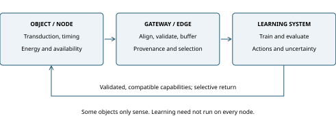

# Low-Power Sensing for an Internet of Intelligence

## Materials, Distributed Architectures, and World-Model Learning

AnimaFoundry

Review preprint, version 1.0.0 | 16 October 2026 | Not peer reviewed

## Abstract

Embedding sensing and computation in ordinary objects could expand the physical observations available to machine learning. Whether this expansion supports useful world models depends on more than transistor current or device count. This critical integrative review examines three connected domains: materials and energy conversion for small sensing nodes; implemented sensor-network, chip, and edge architectures; and the conversion of distributed observations into learned dynamics and deployable models. Representative primary studies and official specifications are considered alongside closely related reviews, with explicit separation of device, chip, node, network, and learning-system evidence. Existing work already establishes low-voltage organic circuits, flexible and two-dimensional processors, energy-harvesting learning demonstrations, constrained networking, and embedded inference. These achievements do not jointly establish autonomous, maintenance-free intelligence in every object. We organize their dependencies around energy availability, observation validity, learning utility, and deployment compatibility. The analysis identifies three recurring mismatches: component efficiency is substituted for service energy; raw data volume is substituted for informative physical interaction; and compact model updates are substituted for complete endpoint capability. Transparent arithmetic illustrates traffic, training-throughput, and update-energy dependencies without presenting an empirical scaling law. A final research agenda, originating from AnimaFoundry's proposal, connects low-power materials, heterogeneous sensing, world-model learning, and selective redistribution. Its central hypothesis is conditional: coordinated design may increase validated task benefit per unit lifecycle cost and energy, provided that data semantics, interventions, failure modes, and endpoint constraints are measured together.

**Keywords:** low-power sensing; Internet of Intelligence; Internet of Things; energy harvesting; edge intelligence; world models; data provenance; model deployment.

## 1. Introduction

The prospective diffusion of artificial intelligence into everyday objects raises a physical question: which objects can acquire useful observations, communicate them at acceptable cost, and benefit from the models trained on the resulting data? The question connects materials research to distributed systems and machine learning. It is tempting to assume that a sufficiently small, low-current chip makes this chain almost automatic. Each link, however, has an independent feasibility condition. A sensing material must produce a sufficiently stable measurement; a node must meet an energy and availability budget; its data must represent the variables required by a learning task; and a deployed model must remain compatible with a particular receiver.

The term Internet of Intelligence is established. Yu proposed an intelligence-sharing networking paradigm in 2019, and Tang and colleagues subsequently surveyed its architecture and enabling technologies [1][2]. Miniature networked sensing has an older history, including Smart Dust and TinyOS [3][4]. Contemporary world-model and edge-intelligence reviews already connect distributed perception, learning, planning, and constrained deployment [5][6]. Consequently, neither the name nor the broad observation-learning-action cycle is claimed as a new invention here.

This review addresses a narrower question: **under what jointly specified physical, informational, and computational conditions can widespread low-power sensing improve world-model learning and return useful capabilities to heterogeneous endpoints?** The question is relevant even when training remains centralized. Distributed use does not require distributed ownership of every training resource, nor does distributed data collection require a large model on every sensor. The smallest endpoint may only measure, timestamp, and transmit; a gateway may fuse observations; a larger system may train dynamics; and a task-specific descendant may serve a capable endpoint.

The contribution is a critical synthesis and a testable research agenda. It is not a new semiconductor material, networking protocol, model architecture, or demonstrated end-to-end platform. The synthesis keeps system boundaries visible and treats failures as evidence. Its emphasis is useful physical coverage and validated deployment, rather than a forecast that the number of connected objects will determine intelligence or economic returns. The hypothesis that materials and architecture are major bottlenecks is retained, but their dominance must be established for a specified application rather than assumed universally.

## 2. Review scope and evidence method

### 2.1 Selection and reading procedure

This is a targeted critical integrative review, not a systematic review or meta-analysis. Searches and primary-source checks were conducted on 16 October 2026. Three domain passes covered materials and energy, implemented architectures, and world-model learning. A fourth pass examined overlapping reviews and the proposed cross-domain claims. Search families included Internet of Intelligence surveys; ultra-low-power, organic, flexible, two-dimensional, and in-memory electronics; harvesting and intermittent computation; Smart Dust, TinyOS, constrained Internet protocols and TinyML; and world models, robot datasets, federated learning, compression, and updates. Exact representative queries, inclusion decisions, source URLs, and reading depth are provided in the accompanying evidence records.

Inclusion favored an identifiable primary paper, author-hosted manuscript, official specification, or datasheet that supported a specific comparison. Historical anchors were retained when they constrained a claim of novelty. Related reviews were used to locate intellectual overlap, not counted as independent experimental replications. Marketing forecasts, untraceable performance claims, and examples requiring inaccessible underlying methods were excluded from quantitative comparisons. Where only an abstract or indexed primary passage was accessible, the supported statement is correspondingly narrow. The search was not preregistered, the corpus is selective, and publication and accessibility biases remain.

The evidence records distinguish inspected primary text, indexed primary text, and related reviews. They also distinguish fabricated devices, integrated prototypes, implemented systems, specifications, simulations, and conceptual proposals. Reported measurements remain the original authors' results; this review does not reproduce the hardware or model experiments. Separate AI-agent checks of the synthesis are an internal quality procedure, not independent human peer review. No statistical pooling is attempted because workloads, energy boundaries, fabrication processes, and learning objectives differ substantially.

### 2.2 Relationship to existing reviews

Table 1 identifies substantial overlap. Its final column describes the emphasis adopted here; it does not establish an exclusive gap or priority claim.

| Existing review | Established coverage | Emphasis in this review |
| --- | --- | --- |
| Tang et al. [2] | Layered Internet of Intelligence and enabling technologies | Physical measurement and endpoint constraints within the learning cycle |
| Zhou et al. [7] | Edge training and inference architectures | Material and energy conditions that determine the observations available |
| Gorecki et al. [8] | Full-cycle AIoT energy accounting and break-even analysis | Consequences for training-data selection and model-return budgets |
| Zhao et al. [5] | World models and agentic intelligence at the edge | Heterogeneous sensor provenance and measurement quality |
| Yang et al. [6] | Sensor-state-decision organization of embodied world models | Energy-dependent missingness and lifecycle deployment constraints |
| Kirchner et al. [9] | World-model uncertainty, planning, and control | Physical sensing and distribution budgets around those objectives |

Near-sensor computing and TinyML are also mature review subjects [10][11]. Recent TinyML work already discusses concept drift and updates under intermittent energy [12]. Additive energy accounting, layered architectures, and selective model delivery should therefore be understood as established ideas applied together, not newly discovered principles. This review's usefulness rests on the quality and falsifiability of that application.

## 3. Materials and energy for small sensing nodes

### 3.1 What low current does and does not specify

Current is not a sufficient efficiency metric. For a constant supply, power is voltage multiplied by current; energy is the time integral of power. A node averaging microamperes can draw much larger currents during acquisition, transmission, or flash writes. Conversely, a low-current device can perform so slowly that energy per completed useful task remains unfavorable. A meaningful comparison fixes measurement quality, workload, latency, availability, and the boundary at which energy is measured.

For non-overlapping operating states s, average supply power can be written as:

```equation
P_avg = sum_s d_s P_s,          sum_s d_s = 1.                 (1)
```

Here d_s is the fraction of time in state s, and P_s is the mean of instantaneous voltage times current within that state. It equals V_s I_s when both are constant; multiplying two separate means is not generally equivalent. If subsystems operate concurrently, their powers must instead be combined without double counting. A measured MCU supply may already include its memory and ADC. Reporting those components again as separate additions would inflate a system estimate. The relevant service metric is energy per valid observation or accepted decision, together with the fraction of required observations or decisions actually delivered.

Established silicon already demonstrates that architecture and duty cycle can dominate low average power. The 2008 Phoenix research processor reported 29.6 pW sleep power while retaining half its data memory, but that is neither active inference power nor a radio-inclusive node budget [13]. A commercial MSP430FR599x datasheet specifies operating and retention modes for a FRAM MCU; its active-current coefficient must be interpreted with supply, frequency, cache behavior, and baseline current [14]. These examples make contemporary CMOS and conventional sensing a necessary baseline for proposed new materials.

### 3.2 Material families solve different problems

Organic, metal-oxide, two-dimensional, piezoelectric, and memory materials should not be ranked on a single small-current axis. They address different constraints, including conformability, transduction, integration density, nonvolatile state, and energy conversion. Table 2 separates representative demonstrated capabilities from the system claim that would still require evidence.

| Route and representative evidence | Demonstrated capability | Boundary that remains |
| --- | --- | --- |
| Low-voltage organic complementary circuits [15] | Gates and ring oscillators at 1.5-3 V; very low static gate current | Switching speed, full-node workload, aging, and yield |
| Flexible metal-oxide processor [16] | A natively flexible 32-bit Arm processor prototype | Flexibility does not establish energy autonomy |
| Two-dimensional semiconductor processor [17] | Programmable 32-bit RISC-V integration using MoS2 | Full-node energy, volume manufacturing, yield, and lifetime |
| Piezoelectric and triboelectric conversion [18][19] | Conversion of mechanical excitation into electrical output | Available excitation, usable DC energy, storage, and durability |
| Indoor photovoltaic learning system [20] | Harvesting integrated with wireless inference demonstrations | Illumination, collector area, outages, and task scale |
| Phase-change-memory inference [21][22] | Fabricated mixed-signal inference chips | Converters, digital support, host costs, calibration, and model fit |

Klauk and colleagues reported organic complementary circuits with static current below 100 pA and static dissipation below 1 nW per gate, measured in ambient air at room temperature using specified semiconductor and dielectric structures [15]. Their ring-oscillator results also expose a speed boundary. A gate-level static measurement cannot support a claim of high-throughput, maintenance-free inference. The significance is that material choice and complementary topology can work together; the result does not make organic electronics a universal replacement for silicon.

Flexible processors address placement on surfaces and objects. Biggs and colleagues' PlasticARM demonstration establishes substantial computation on a flexible substrate, while Ao and colleagues' two-dimensional semiconductor processor moves beyond isolated transistors toward programmable integration [16][17]. Neither observation alone establishes a lower energy per useful task than a matched CMOS design. Atomic channel thickness is not the thickness of the finished package, and flexibility is not equivalent to low supply voltage, inexpensive manufacturing, or environmental robustness. Hybrid systems may therefore be more relevant than wholesale substitution: a conformable transducer can connect to a conventional MCU, memory, or radio.

Materials evaluation should extend beyond nominal sensitivity and switching. Contact resistance, drift, contamination, encapsulation, bending, temperature, retention, and production variation can alter the delivered observation. An accurate but rapidly drifting sensor may require calibration whose energy and maintenance cost exceed a more stable alternative. An inference accelerator may require frequent conductance correction or weight programming. These are application-specific comparison requirements, not a claim that every emerging material fails them. This review does not comprehensively evaluate perovskite stability, lead-free piezoelectrics, FeFET computing, packaging lifecycle assessment, or wafer-scale manufacturing economics.

### 3.3 Harvesting and communication must be evaluated as a system

Harvesting changes the power source; it does not eliminate the energy budget. The original ZnO nanowire and triboelectric demonstrations depended on mechanical excitation [18][19]. Peak voltage or power density cannot be substituted for continuous usable power at an unspecified location. A stationary object can offer little mechanical input. Rectification, impedance matching, storage leakage, cold start, and conversion losses must be measured under the actual excitation distribution.

Michaels and colleagues already joined indoor photovoltaics, wireless nodes, and machine learning in an experimental system [20]. Their reported output depends on illumination spectrum and collector area: under fluorescent light, reported power density varies from 19 to 103 microW/cm2 between 200 and 1,000 lux. This is evidence for integrated feasibility under stated conditions, not for a microscopic autonomous world-model trainer. Lux does not uniquely specify radiometric power. A deployment needs both illuminated and dark intervals, rather than a favorable laboratory average alone.

For ideal capacitive storage, the usable energy between voltage thresholds is:

```equation
E_buffer,ideal = C (V_high^2 - V_low^2) / 2.                   (2)
```

Actual usable energy is lower after conversion losses and operational reserves. Storage-aware feasibility requires enough energy for startup and required bursts at the time they occur. Over long horizons, energy delivered by the harvester at the chosen node boundary must at least match energy drawn there, with losses counted once within the same boundary. This balance does not guarantee a deadline through a long dark interval: finite storage and supply timing can still cause service failures. Work may also be lost or repeated across brownouts.

Ambient backscatter illustrates a complementary architectural trade-off. Liu and colleagues demonstrated communication by modulating existing RF signals, reducing the need for a locally generated carrier [23]. This shifts attention to the incident field, antenna, receiver, and propagation conditions. Battery-free is neither infrastructure-free nor proof of low whole-network energy. The cost of readers, gateways, and continuous listening must remain inside the boundary whenever a system-level efficiency claim is made.

### 3.4 In-memory and near-sensor computation

Moving computation toward sensors or memory can reduce data movement, an established motivation in near-sensor computing [10]. The benefit depends on what information can be discarded and what conversions remain. Ambrogio and colleagues reported a phase-change-memory speech-inference chip with sustained efficiency reaching 12.4 TOPS/W, while their estimated combined analog/digital system was about 6.7 TOPS/W for the evaluated workload [21]. The two figures describe different boundaries; the latter is an estimate, not an equivalent measured autonomous node.

Le Gallo and colleagues provide another concrete mixed-signal chip example, incorporating conversion, digital processing, and communication [22]. Operating modes used for throughput and for accuracy must not be combined into a nonexistent best-case configuration. More generally, TOPS/W comparisons require arithmetic precision, utilization, operation counting, sparsity, workload, accuracy, and host overhead. An excellent matrix-operation result does not establish efficient sensing, foundation-model training, or reliable long-horizon planning.

## 4. Implemented networking and chip architectures

### 4.1 From sensor networks to heterogeneous edge systems

Smart Dust framed integrated sensing, computation, communication, and power at very small scale [3]. Its architectural ambition should not be confused with universal deployment. TinyOS provides stronger evidence of implemented sensor-network software and reported application deployments, including habitat monitoring [4]. Event-driven execution, collection trees, synchronization, dissemination, and radio duty cycling were already concrete engineering concerns. The historical lesson is that a useful network requires coordination and maintenance, not merely smaller hardware.

The constrained Internet stack separates several problems. RFC 4944 defines adaptation of IPv6 packets to IEEE 802.15.4 links; RFC 6550 defines RPL routing for low-power and lossy networks; RFC 7252 defines CoAP application exchanges [24][25][26]. These are historical base specifications with subsequent updates, not complete current deployment profiles. Addressability, routing, and retransmission do not establish physical identity, calibrated units, accurate clocks, authorization, or exactly-once effects across arbitrary failures. Standards are evidence of specified interfaces, not counts of working installations.

Fog and edge computing place management, analytics, and applications between endpoints and clouds [27][7]. Their relevance here is the allocation of responsibilities. A gateway can buffer during disconnection, validate schemas, maintain time mappings, and host a larger estimator than a harvester-powered endpoint. Centralized training can coexist with local control. Conversely, moving processing to the edge can increase aggregate idle energy or duplicate work; its advantage depends on workload, latency, privacy constraints, and communication costs.

### 4.2 Endpoint classes and model placement

The word endpoint covers materially different systems. Table 3 distinguishes capabilities without assigning universal memory or power thresholds. A device moves between classes only when its actual resource and service budgets allow it.

| Endpoint class | Typical role in the learning cycle | Plausible returned capability |
| --- | --- | --- |
| Sensor or passive tag | Acquire an identifier, event, or measurement | Where supported: sampling parameters, thresholds, or calibration; possibly no executable model |
| MCU node | Filter, encode, classify, and buffer | A compiled small estimator or task-specific policy |
| Gateway or local accelerator | Align modalities, fuse context, and coordinate local services | A larger student, specialist dynamics model, or compatible adapter |
| Training-capable system | Curate data, optimize models, and validate descendants | Shared representations, teachers, model families, and release artifacts |

MCUNet demonstrates why model/runtime co-design matters [28]. Its reported 70.7% ImageNet top-1 result uses 4-bit quantization on an STM32H743 with 512 kB SRAM and 2 MB flash. It should not be attached to a generic MCU or an energy-harvesting operating point. SRAM for intermediate activations and flash for parameters are distinct constraints. The result establishes embedded task inference; it does not establish universal world-model training on the same hardware.

Event-based vision and neuromorphic processing offer different observation and computation interfaces. Lichtsteiner and colleagues' sensor emits events responding to local intensity changes rather than conventional frames [29]. Event rate remains scene-dependent, and the bus can saturate. An event stream is an observation model with omissions and noise, not a lossless representation made free by sparsity. Intel's Loihi 2 brief establishes a research hardware architecture [30]. The associated signal-processing study by Orchard and colleagues reports experiments on emulated Loihi 2 hardware [31]. No simulated efficiency gain is treated here as a measured node result.

### 4.3 Intermittent operation and failure semantics

Low average consumption does not imply continuous execution. Mementos and Alpaca address progress or memory consistency when energy failure destroys volatile state [32][33]. Their results depend on energy traces, execution granularity, and platform assumptions. Persistent memory helps preserve computation but does not preserve the physical world while a device is off. An old sensor reading remains old after successful recovery.

The distinction extends to effects outside memory. A checkpoint or atomic task commit cannot alone prove that a radio message, actuator movement, or physical measurement happened exactly once. A learning system should therefore retain boot epochs, observation times, uncertainty, sequence identifiers, and explicit missingness where the device can support them. These fields enable diagnosis; they do not reconstruct events that were never observed. If the sensor cannot maintain a trustworthy clock through interruption, the gateway must represent that uncertainty rather than silently fabricate alignment.

### 4.4 An end-to-end decomposition

Figure 1 organizes the reviewed components. The arrows represent interfaces and responsibilities, not a new protocol. Acquisition includes the transducer, front end, and ADC where appropriate; event-based sensors may expose a different encoding. Gateways can retain provenance alongside payloads. Training and deployment operate on distinct versioned artifacts.



**Figure 1.** An analytical decomposition of the sensing-to-learning cycle. Returned artifacts are selected for the receiver; the diagram does not require every endpoint to host a world model. Energy, timing, calibration, permission, and compatibility constraints cross the interfaces. The schematic is original to this review and does not reproduce a source figure.

SenML already provides a compact measurement representation with names, times, values, and units [34]. A world-model dataset needs additional guarantees that cannot be inferred from syntax alone: calibration validity, coordinate transforms, sensor placement, preprocessing versions, and the acquisition policy. Some metadata can be referenced once per deployment interval instead of repeated per sample. The useful target is a traceable observation contract, not maximum metadata traffic or a proprietary replacement for existing formats.

## 5. From distributed observations to world models

### 5.1 Separate representation, dynamics, and policy

A predictive representation encodes observations for downstream use. An action-conditioned dynamics model predicts future state or latent trajectories given candidate actions. A policy maps observations and goals to actions. These functions may be combined, but evidence for one is not automatically evidence for the others. A device classifier is not a world model merely because its training data came from many locations. A visually plausible generated video is not sufficient evidence of useful control predictions.

One common abstraction under partial observability is:

```equation
z_t = encoder(o_<=t, a_<t);                                  (3)
p(z_(t+1), r_t | z_t, a_t) = learned dynamics and reward model.
```

Here o denotes observations, a recorded actions, z a learned state, and r a task-dependent reward where applicable. This notation summarizes a family of approaches; not every world model has an explicit reward head or probabilistic output. DreamerV3 learns compact dynamics and uses imagined trajectories for behavior learning [35]. Its breadth across tasks does not mean one jointly trained model understands all physical environments.

V-JEPA 2 offers a useful distinction between learning from passive video and learning action consequences [36]. Its action-free stage uses a large video corpus, followed by action-conditioned post-training with robot data. The reported approximately 62 hours of robot data are dataset duration, not elapsed training time. The paper also reports camera-pose sensitivity, accumulated prediction error, long-horizon planning difficulty, and dependence on image goals. These conditions matter when considering transfer from heterogeneous sensors to control.

### 5.2 Useful observations require physical and temporal semantics

An object network can produce abundant numbers while leaving a target process poorly observed. Temperature without placement, motion without a coordinate frame, or a command without the actuator's actual response can make apparent correlations ambiguous. Acquisition should identify the physical quantity, unit, timing uncertainty, calibration interval, device and firmware versions, quality flags, and relevant operating context. Control-oriented datasets additionally need action conventions, execution delays, outcomes, human interventions, and safety overrides. This is a proposed reporting contract informed by the literature, not an assertion that all reviewed datasets implement it.

Data selection itself changes the distribution. A photovoltaic node reports preferentially when light and stored energy permit operation. An event-triggered sensor may suppress stationary conditions. A network can lose records during congestion precisely when many devices experience an unusual event. Such missingness may carry information about the process and the observation system. Removing it during cleaning can conceal the conditions under which a learned model will be asked to operate.

Observational prediction and intervention prediction must remain distinct [37]. Passive streams may support representation learning, forecasting, and causal analysis under justified assumptions. Their scale alone does not identify the effect of an untried action. Recording actions is also insufficient if behavior policies, hidden state, or selection create unresolved confounding. Controlled interventions, mechanistic assumptions, or other identifying information must be specified where counterfactual claims are made. A model can be useful without making such claims; its evaluation should match its actual objective.

### 5.3 Heterogeneous data are valuable but not uniformly beneficial

Open X-Embodiment demonstrates the importance of collecting and standardizing robot trajectories across embodiments, while retaining different action meanings and coordinate conventions [38]. Its RT-X results include positive transfer in some settings and performance regressions attributed by the authors to underfitting in others. In the inspected Google Robot six-skill setting, RT-1-X achieves 73% success versus 92% for RT-1; RT-2-X achieves 91%. This bounded result shows that a larger mixture and a fixed model do not guarantee improvement. It does not establish that mixed-embodiment learning is generally harmful, and these are policy evaluations rather than direct proof of a learned dynamics model.

DROID reports 76,000 demonstration trajectories, 350 interaction hours, and 564 scenes [39]. Those quantities reflect intentional collection and diversity, rather than passive telemetry from arbitrary objects. Octo demonstrates adaptation of a generalist policy, but its authors qualitatively report that adding proprioceptive inputs appeared to worsen policy performance [40]. They hypothesize causal confusion; the observation is not a separately quantified or statistically established effect. It cautions against assuming automatic benefit from additional sensors, rather than supporting universal rejection of proprioception.

The evaluation unit should therefore include held-out devices, sites, operating regimes, and episodes. Randomly splitting adjacent time windows can leak nearly identical context into training and evaluation. Calibration changes, sensor loss, different sampling policies, and new action conventions deserve explicit tests. Improvements should be measured against strong alternatives: a well-calibrated sparse network, a mechanistic or task-specific predictor, and an existing model adapted with a small amount of relevant interaction data. More nodes must compete with better placement, better labels, and better coverage of rare events.

### 5.4 Centralized, federated, and local learning

Centralized ingestion simplifies joint curation but can be limited by bandwidth, permissions, or governance. Federated averaging aggregates locally computed updates while leaving raw examples at clients [41]. Its practicality depends on compatible parameterization, local memory and compute, communication rounds, and participation. Statistical and systems heterogeneity, availability bias, and personalization are established challenges [42]. Harvesting endpoints may be better treated as data sources than as training participants; a gateway can provide a more appropriate federation boundary.

Local data retention is not a complete privacy guarantee. Demonstrated gradient leakage shows that shared updates can reveal training content under particular adversarial conditions [43]. Security and privacy depend on the actual protocol and threat model. Nor does federation imply decentralized governance: a coordinating server can still determine participation, objectives, and deployment. The choice among centralized, federated, and local learning should follow the task and rights boundary, rather than a presumption that one topology always minimizes energy or distributes control fairly.

## 6. Scaling data, training, and elapsed time

### 6.1 Raw volume is a transport quantity

For node i with active sampling rate f_i, duty fraction d_i, and payload size b_i bytes, a recording interval H gives:

```equation
B_payload = H sum_i d_i f_i b_i.                              (4)
```

Headers, timestamps, authentication, retransmissions, indexes, replication, and retained raw media are additional costs. Compression and filtering change bytes but do not provide a general conversion to useful information. Distinct records, trajectories, selected windows, model tokens, optimizer updates, and independent observations are different counts. A tokenizer is part of the model specification; it cannot be inferred from the number of ADC samples.

Table 4 is an illustrative calculation, not a deployment projection. It assumes one million always-available nodes, six channels per node, 16 bits per channel, and no overhead. The last column retains one tenth of payload bytes; it makes no assumption that one tenth preserves the required learning value. Decimal GB and TB are used throughout.

| Sampling rate per channel | Raw payload per day | Payload after hypothetical 10% retention |
| --- | --- | --- |
| 0.1 Hz | 0.10368 TB | 10.368 GB |
| 1 Hz | 1.0368 TB | 103.68 GB |
| 10 Hz | 10.368 TB | 1,036.8 GB |

At 1 Hz, treating each simultaneous six-channel reading as one joint sample yields 86.4 billion samples per day before selection. In the following separate sampling scenario, 10% of complete, fixed-size joint records are retained without re-encoding, yielding 8.64 billion samples. A generic 10% compressed byte rate would not imply this sample count. Neither count measures independent physical transitions: readings can be repetitive, spatially correlated, misaligned, or irrelevant to the target. A redundancy estimate must be tied to a statistic or task; there is no universal effective-sample multiplier for an arbitrary multimodal world model.

### 6.2 Training time requires an implementation and a workload

Let selected windows j produce k_j tokens, and let E denote complete training passes. The processed-token count is E times the sum of k_j only when the training schedule actually makes those passes; replay, masking, resampling, and online learning require their own accounting. Hoffmann and colleagues' language-model experiments motivate joint model/data budgeting, but their fitted scaling behavior is not an established law for correlated sensor data, latent dynamics, video encoders, or closed-loop control [44].

Training compute and a compute-only duration can be expressed as:

```equation
C_train = sum_u C_step,u;   T_compute = C_train / F_attained.  (5)
```

The sum covers actual optimizer updates, and F_attained is sustained useful aggregate throughput on the specified system. Vendor peak arithmetic throughput is not a substitute. Architecture, precision, context length, encoder resolution, activation memory, communication, and loss formulation change the workload. Evaluation and student distillation add their own compute. Under ideal overlap, the maximum of compute, input, and communication times is a lower bound for those stages; non-overlapped work, failures, and scheduling increase elapsed time.

As a separate hypothetical throughput example, two passes over 8.64 billion retained joint samples at a sustained 50,000 samples per second require 345,600 seconds, or 96 hours. The throughput is assumed, not measured, and no particular model is claimed to achieve it. Doubling the retained examples doubles this arithmetic only if throughput and passes remain fixed. Changing context length, model size, sampling, or cluster parallelism can invalidate that condition. The accompanying script reproduces this example using exact decimal arithmetic.

Collection time, preprocessing time, accelerator training time, adaptation time, and deployment time must be reported separately. Some stages overlap, so their sum is not always the end-to-end duration; the critical path determines delivery. Acquiring rare failures or authorized interventions may dominate that path even when training is fast. Conversely, a flood of inexpensive data can exhaust curation or compute budgets. No defensible universal prediction of training duration or final capability follows from a ten-to-twenty-year horizon or a projected node count.

### 6.3 Growth should be evaluated as marginal utility

A useful research objective is incremental validated task benefit at a fixed comparison budget. If D is a baseline dataset and D_i an additional stream, compare the model trained with D_i against a matched alternative, controlling training compute and reporting collection energy and cost. The difference in task utility is conditional on the model, task, selection procedure, and baseline. It need not be positive, additive across sensors, or stable under deployment shift.

This suggests a staged scaling experiment: vary sensor density, placement, calibration quality, and intervention coverage separately; then examine their interactions. Report prediction quality, uncertainty calibration, closed-loop performance where applicable, energy per accepted observation, and maintenance cost. A larger dataset that improves an offline average while worsening rare-event safety or availability is not an unqualified system improvement. The appropriate result may be a Pareto frontier rather than a single intelligence-per-watt score.

## 7. Returning learned capabilities to receivers

### 7.1 Model families instead of one universal download

Knowledge distillation can transfer behavior from a larger teacher to a smaller student, and integer quantization can reduce deployment costs under suitable training and hardware conditions [45][46]. Neither method guarantees preservation of physical uncertainty or rare-event behavior. Each descendant needs evaluation on the receiving platform and task. A tiny sensor may receive a threshold or sampling schedule; an MCU may receive a compiled estimator; a gateway may receive a larger model; and the cloud may retain the full teacher. Participation in the network does not imply equal capability at every node.

Low-rank adaptation reduces the number of trainable update parameters but retains the frozen base model [47]. An adapter is useful only where the receiver has the matching base, operators, preprocessing, and memory. Sending a small adapter to an incompatible or underpowered endpoint does not make the full computation feasible. Other choices include specialist models, partial inference offload, or remotely queried predictions, each with latency, availability, and privacy trade-offs.

### 7.2 Updates consume energy and must survive failure

For P parameters stored using q bits each, ideal weight payload is Pq/8 bytes before scales, metadata, code, and checks. Consider an illustrative one-million-parameter, 4-bit model: weights alone occupy 0.5 MB. Unicast delivery to one million endpoints totals 0.5 TB of endpoint payload. Gateway caching can reduce duplicate upstream transfer, but every intended receiver still incurs its last-hop and storage costs.

At a hypothetical receiver energy of 100 nJ/bit, receiving those four million bits requires 0.4 J before verification, writes, or retransmission. A hypothetical 10 microW of surplus harvested power would take 40,000 seconds, about 11.11 hours, to supply that receive energy alone. These are assumed inputs for sensitivity analysis, not specifications of a cited radio. They illustrate why an infrequent update can be material even when routine inference is inexpensive. Measured transaction energy should replace the per-bit approximation when setup and listening dominate.

RFC 9019 already describes firmware-update roles, verification, recovery, and constrained-device cases [48]. RFC 9124 specifies a manifest information model including compatibility and sequence information [49]. Both are Informational RFCs, not claims that a complete world-model deployment standard already exists. Applying their principles to models requires explicit binding of weights, base model, tokenizer or feature encoder, calibration dependencies, runtime, and operator implementations. A valid signature authenticates an artifact's origin and integrity; it does not prove that its predictions are physically correct.

Activation should be separated from transfer. Receivers need adequate storage and energy to validate and install an artifact, preserve a safe recovery route, and report which version is active. A staged rollout can compare task behavior before broader activation. Authorized recovery must be compatible with anti-rollback policy; allowing arbitrary reversion to a vulnerable image is not a safe fallback design. These are engineering requirements for a proposed model lifecycle, not newly implemented guarantees in this paper.

### 7.3 The feedback loop can alter its own evidence

A deployed model can change which events are sampled, which actions are attempted, and which failures humans prevent. Subsequent data therefore reflect the previous model and its operating policy. Training snapshots should preserve these versions and selection rules. Otherwise, a measured improvement may partly reflect changed observation or intervention rather than better dynamics. Validation should include fixed external tasks or evaluation streams where feasible, together with monitoring of acquisition changes. Distributed deployment is complete only when the receiving system's behavior, compatibility, and failure recovery have been assessed; successful file transfer alone is insufficient.

## 8. Research agenda and falsifiable comparisons

The proposed agenda in Table 5 is prospective. No listed experiment is claimed to have been performed. Each comparison requires a specified object class and task, a conventional baseline, declared operating conditions, and a stopping rule. Exact numerical acceptance margins should be set before observing test results; they cannot be responsibly chosen once for all applications.

| Hypothesis | Required comparison | Evidence against the hypothesis |
| --- | --- | --- |
| A material change improves useful sensing efficiency | Emerging material versus conventional sensor at matched noise, bandwidth, service availability, and complete-node boundary | Advantage disappears after readout, packaging, calibration, or maintenance |
| More distributed sensing improves learned dynamics | Added coverage versus better placement/calibration and targeted interaction data under equal training compute | Upper confidence bound excludes the prespecified useful benefit, or harm exceeds a declared tolerance |
| Event selection saves service energy without losing needed evidence | Event-triggered versus periodic acquisition with rare-event and no-event controls | Missingness bias or lost events outweigh the measured energy saving |
| Distributed training is appropriate for a deployment | Gateway federation versus permitted centralized and local alternatives with equal targets | Participation bias, energy, or communication defeats the intended benefit |
| Model redistribution improves endpoint service | Compressed descendant versus existing local model and gateway inference at matched constraints | Calibration, latency, energy, or recovery becomes unacceptable |

A first study should be deliberately bounded. One candidate is a non-safety-critical instrumented object class with known actuator commands and repeatable state transitions. It should compare passive observations alone, passive observations with correctly aligned actions, and targeted additional sensing. Held-out devices and sites should be reserved before model selection. Synthetic data can verify plumbing and arithmetic; it cannot establish field utility. Real observations require collection authority, provenance, and a documented retention policy.

For a prespecified minimum useful improvement delta, a confidence interval entirely above delta supports the targeted benefit; one entirely below delta rules out that benefit at the stated precision; an interval crossing delta is inconclusive. A failure to reach statistical significance is not proof of no effect. Safety, energy, and availability constraints need their own declared tolerances and uncertainty analyses. Sample sizes, independent units, multiple-comparison handling, and any equivalence or noninferiority margins should be chosen before final evaluation.

A concrete prospective template is a benchtop thermal process with temperature sensors, logged heater and fan commands, and measured responses. A 60-second prediction horizon could compare a calibrated thermal resistance-capacitance model, a linear input-output predictor, a small recurrent network, and a learned latent dynamics model. Device-level and operating-session holdouts would test whether extra sensing improves transfer beyond better calibration of a sparse baseline. Heat-source energy and sensing-system energy must be reported separately, with total service energy also available. This is an unexecuted design example; its horizon and acceptance margins require justification for the eventual application. Energy and cost should enter prespecified constraints or Pareto comparisons, rather than a denominator chosen after seeing the results.

Hardware tests should include absent excitation, darkness where relevant, weak links, storage depletion, sensor saturation, calibration drift, and interruption during an update. Learning tests should include timing errors, missing modalities, changed action coordinates, out-of-support conditions, and negative transfer. Deployment tests should include a wrong base-model version, incompatible operators, an incomplete download, failed validation, and recovery to an authorized working state. Repeated measurements must identify independent experimental units; time samples from one device are not automatically independent replicates.

For claimed improvements, report uncertainty and the sampling population, including failed devices and discarded records. A credible result might show that conventional materials plus better sampling outperform a novel transducer, or that calibration matters more than additional nodes. Such outcomes would revise the original bottleneck hypothesis rather than invalidate the research program. A scientifically useful agenda permits the dominant constraint to be data, deployment, economics, or maintenance instead of materials.

## 9. Governance, limitations, and conclusions

Ubiquitous instrumentation can expose information about people and organizations even when the nominal measurement concerns an object. Collection permission, access control, retention, and withdrawal procedures should be part of deployment design. Local processing can reduce transmitted detail but does not automatically remove inference risks. Different participants may retain different control boundaries. The architecture should not require a single entity to receive all raw observations or authorize every local action.

Lifecycle cost includes manufacturing, calibration, gateways, communications, training, updates, repair, and disposal. Making a node smaller does not establish that instrumenting every object is economical or environmentally beneficial. The relevant comparison is the service achieved over its lifetime, including replacement and maintenance. This review provides no market forecast, life-cycle assessment, or universal adoption timetable. The electrical and computing analogies motivating the topic are interpretive context, not empirical evidence for a particular twenty-year trajectory.

The literature selection is bounded and uneven in reading depth. Some numerical results were available only through indexed primary passages; others were examined in selected full-text sections. No hardware, dataset, or model result was independently reproduced. Evidence from language models, robot policies, or classification is not treated as direct validation of generic physical world models. The supplementary records preserve these limits and version differences. A future systematic review could preregister databases, search strings, exclusion rules, screening agreement, and quantitative extraction fields before expanding the corpus.

Three conclusions follow. First, low-power and conformable sensing already has substantial experimental precedent; the relevant question is its incremental advantage at a complete service boundary. Second, the value of distributed data depends on observability, semantics, actions, provenance, and coverage rather than bytes alone. Third, returning learned capability is a heterogeneous deployment problem with energy and compatibility costs of its own. Progress is most credible when these conditions are measured together and when strong conventional alternatives remain in the comparison.

## 10. Research vision proposed by AnimaFoundry

The motivating proposal is to make sensing and limited computation small, inexpensive, and sufficiently energy-efficient to be integrated into a much wider range of ordinary industrial and household objects. Distributed observations from these objects could support learning about physical processes, and the resulting capabilities could then be returned to suitable receivers. Materials research and architectural design are proposed as major enabling directions. This section preserves that conceptual proposal as a research vision; it is not a reported experimental finding or a claim to priority over the work reviewed above.

The proposed cycle has three coupled parts. The first develops transducers, low-leakage circuits, nonvolatile state, packaging, and energy sources that meet specific sensing duties under realistic environmental conditions. The second connects heterogeneous devices through existing or extended network architectures while preserving identity, timing, calibration, and authorized observation context. The third uses selected, aligned observations and interaction records to train representations and dynamics, then distributes validated task-specific capabilities according to receiver resources. A receiver need not obtain the full model, and some objects may participate only as sensing surfaces.

The central testable conjecture is that coordinating these three parts can increase useful physical coverage and validated task performance per unit lifecycle energy and cost. This conjecture has meaningful alternatives. Existing CMOS and conventional networks may already satisfy a task; additional sensors may add redundant or biased records; a large world model may offer no advantage over a small mechanistic or task-specific model; and update costs may exceed the returned benefit. A successful research program must identify the conditions under which the conjecture holds and publish failures as well as successes.

The intended long-term possibility is a broadly accessible infrastructure of physical observation and distributed intelligence. A ten-to-twenty-year horizon is an organizing scenario, not a forecast supported by this review. Universal instrumentation is neither a requirement nor an objective independent of usefulness, consent, repairability, and cost. The scientifically defensible ambition is more precise: make participation in a learning network feasible for many more classes of object, while demonstrating that each added capability provides measurable benefit under explicit constraints.

## Declarations

**Concept and provenance.** The motivating research vision was supplied by AnimaFoundry. Literature synthesis, drafting, arithmetic tooling, and internal checks used OpenAI Codex. AI tools are not listed as authors. This release has not undergone independent human peer review, and no unverified affiliation or external endorsement is claimed.

**Evidence and data.** The release contains newly written synthesis, bibliographic metadata, an original schematic, and explicitly hypothetical calculations. It does not redistribute source papers, source figures, model weights, private telemetry, or operational datasets. Source and method records accompany the manuscript.

**Rights.** Original text and schematic are released under CC BY 4.0; original helper code is MIT licensed. Cited works retain their own rights. A literature review and an open license do not establish patent freedom to operate. No material, device, or implementation is offered as a cleared invention.

## References

[1] F. Richard Yu. From the Internet of Information to the Internet of Intelligence. arXiv:1909.08068, 2019. https://arxiv.org/abs/1909.08068

[2] Qinqin Tang et al.. Internet of Intelligence: A Survey on the Enabling Technologies, Applications, and Challenges. IEEE Communications Surveys & Tutorials, 2022. https://doi.org/10.1109/COMST.2022.3175453

[3] Joseph M. Kahn, Randy H. Katz, and Kristofer S. J. Pister. Emerging Challenges: Mobile Networking for Smart Dust. Journal of Communications and Networks 2(3), 188-196, 2000. https://ee.stanford.edu/~jmk/pubs/jcn.00.pdf

[4] Philip Levis et al.. The Emergence of Networking Abstractions and Techniques in TinyOS. NSDI, USENIX, 2004. https://www.usenix.org/conference/nsdi-04/emergence-networking-abstractions-and-techniques-tinyos

[5] Changyuan Zhao et al.. Edge General Intelligence Through World Models and Agentic AI: Fundamentals, Solutions, and Challenges. arXiv:2508.09561v1, 2025. https://arxiv.org/abs/2508.09561

[6] Yi Yang, Hao Feng, and Beichen Lu. Sensor-Driven World Models for Embodied Intelligence: A Survey of Sensor-State-Decision Modeling Across Far-Field and Near-Field Regimes. Sensors 26(18), 5944, 2026. https://doi.org/10.3390/s26185944

[7] Zhi Zhou et al.. Edge Intelligence: Paving the Last Mile of Artificial Intelligence With Edge Computing. Proceedings of the IEEE, 2019. https://doi.org/10.1109/JPROC.2019.2918951

[8] Sebastian Gorecki, Slawomir Hausman, and Piotr Korbel. Cross-Layer Energy Management in Embedded AIoT Sensor Networks: A Structured Review, Full-Cycle Energy Model, and Break-Even Analysis. Electronics 15(17), 4000, 2026. https://doi.org/10.3390/electronics15174000

[9] Sven Kirchner, Nils Purschke, and Alois Knoll. A survey of world models for physical AI with uncertainty representation and control. Discover Artificial Intelligence 6, 1037, 2026. https://doi.org/10.1007/s44163-026-02122-1

[10] Feichi Zhou and Yang Chai. Near-sensor and in-sensor computing. Nature Electronics 3, 664-671, 2020. https://doi.org/10.1038/s41928-020-00501-9

[11] Ji Lin, Ligeng Zhu, Wei-Ming Chen, Wei-Chen Wang, and Song Han. Tiny Machine Learning: Progress and Futures. arXiv:2403.19076, 2024. https://arxiv.org/abs/2403.19076

[12] Prasoon Raghuwanshi et al.. TinyML for On-Device and Edge Analytics in Wireless Networks: A Survey of Deployments, Opportunities, and Concept-Drift Mitigation. arXiv:2606.30843, 2026. https://arxiv.org/abs/2606.30843

[13] Mingoo Seok et al.. The Phoenix Processor: A 30pW Platform for Sensor Applications. Symposium on VLSI Circuits, 188-189, 2008. https://blaauw.engin.umich.edu/wp-content/uploads/sites/342/2018/02/Mingoo-Seok-The-Phoenix-Processor-A-30pW-Platform-for-Sensor-Applications.pdf

[14] Texas Instruments. MSP430FR599x, MSP430FR596x Mixed-Signal Microcontrollers. Datasheet SLASE54D; March 2016, revised January 2021, 2021. https://www.ti.com/lit/ds/symlink/msp430fr5994.pdf

[15] Hagen Klauk, Ute Zschieschang, Jens Pflaum, and Marcus Halik. Ultralow-power organic complementary circuits. Nature 445, 745-748, 2007. https://doi.org/10.1038/nature05533

[16] John Biggs et al.. A natively flexible 32-bit Arm microprocessor. Nature 595, 532-536, 2021. https://doi.org/10.1038/s41586-021-03625-w

[17] Mingrui Ao et al.. A RISC-V 32-bit microprocessor based on two-dimensional semiconductors. Nature 640, 654-661, 2025. https://doi.org/10.1038/s41586-025-08759-9

[18] Zhong Lin Wang and Jinhui Song. Piezoelectric Nanogenerators Based on Zinc Oxide Nanowire Arrays. Science 312, 242-246, 2006. https://doi.org/10.1126/science.1124005

[19] Feng-Ru Fan, Zhong-Qun Tian, and Zhong Lin Wang. Flexible triboelectric generator. Nano Energy 1, 328-334, 2012. https://doi.org/10.1016/j.nanoen.2012.01.004

[20] Hannes Michaels et al.. Dye-sensitized solar cells under ambient light powering machine learning: towards autonomous smart sensors for the internet of things. Chemical Science 11, 2895-2906, 2020. https://doi.org/10.1039/C9SC06145B

[21] Stefano Ambrogio et al.. An analog-AI chip for energy-efficient speech recognition and transcription. Nature 620, 768-775, 2023. https://doi.org/10.1038/s41586-023-06337-5

[22] Manuel Le Gallo et al.. A 64-core mixed-signal in-memory compute chip based on phase-change memory for deep neural network inference. Nature Electronics 6, 680-693, 2023. https://doi.org/10.1038/s41928-023-01010-1

[23] Vincent Liu et al.. Ambient Backscatter: Wireless Communication Out of Thin Air. ACM SIGCOMM, 39-50, 2013. https://abc.cs.washington.edu/files/comm153-liu.pdf

[24] Gabriel Montenegro et al.. Transmission of IPv6 Packets over IEEE 802.15.4 Networks. RFC 4944, 2007. https://www.rfc-editor.org/rfc/rfc4944

[25] Tim Winter et al.. RPL: IPv6 Routing Protocol for Low-Power and Lossy Networks. RFC 6550, 2012. https://www.rfc-editor.org/rfc/rfc6550

[26] Zach Shelby, Klaus Hartke, and Carsten Bormann. The Constrained Application Protocol (CoAP). RFC 7252, 2014. https://www.rfc-editor.org/rfc/rfc7252

[27] Michaela Iorga et al.. Fog Computing Conceptual Model. NIST SP 500-325, 2018. https://doi.org/10.6028/NIST.SP.500-325

[28] Ji Lin et al.. MCUNet: Tiny Deep Learning on IoT Devices. NeurIPS, 2020. https://arxiv.org/abs/2007.10319

[29] Patrick Lichtsteiner, Christoph Posch, and Tobi Delbruck. A 128 x 128 120 dB 15 us Latency Asynchronous Temporal Contrast Vision Sensor. IEEE Journal of Solid-State Circuits 43(2), 566-576, 2008. https://doi.org/10.1109/JSSC.2007.914337

[30] Intel Labs. Taking Neuromorphic Computing to the Next Level with Loihi 2. Technology brief, 2021. https://download.intel.com/newsroom/2021/new-technologies/neuromorphic-computing-loihi-2-brief.pdf

[31] Garrick Orchard et al.. Efficient Neuromorphic Signal Processing with Loihi 2. arXiv:2111.03746, 2021. https://arxiv.org/abs/2111.03746

[32] Benjamin Ransford, Jacob Sorber, and Kevin Fu. Mementos: System Support for Long-Running Computation on RFID-Scale Devices. Technical report UM-CS-2010-060, 29 October 2010, 2010. https://web.cs.umass.edu/publication/docs/2010/UM-CS-2010-060.pdf

[33] Kiwan Maeng, Alexei Colin, and Brandon Lucia. Alpaca: Intermittent Execution without Checkpoints. Proceedings of the ACM on Programming Languages 1(OOPSLA), 96, 2017. https://doi.org/10.1145/3133920

[34] Cullen Jennings et al.. Sensor Measurement Lists (SenML). RFC 8428, 2018. https://www.rfc-editor.org/rfc/rfc8428

[35] Danijar Hafner, Jurgis Pasukonis, Jimmy Ba, and Timothy Lillicrap. Mastering diverse control tasks through world models. Nature 640, 647-653, 2025. https://doi.org/10.1038/s41586-025-08744-2

[36] Mahmoud Assran et al.. V-JEPA 2: Self-Supervised Video Models Enable Understanding, Prediction and Planning. arXiv:2506.09985v1, 2025. https://arxiv.org/abs/2506.09985

[37] Bernhard Scholkopf et al.. Toward Causal Representation Learning. Proceedings of the IEEE 109(5), 612-634, 2021. https://doi.org/10.1109/JPROC.2021.3058954

[38] Open X-Embodiment Collaboration. Open X-Embodiment: Robotic Learning Datasets and RT-X Models. ICRA; preprint initially 2023, 2024. https://arxiv.org/abs/2310.08864

[39] Alexander Khazatsky et al.. DROID: A Large-Scale In-The-Wild Robot Manipulation Dataset. Robotics: Science and Systems; revised preprint 2025, 2024. https://arxiv.org/abs/2403.12945

[40] Octo Model Team et al.. Octo: An Open-Source Generalist Robot Policy. arXiv:2405.12213v2, 2024. https://arxiv.org/abs/2405.12213

[41] H. Brendan McMahan et al.. Communication-Efficient Learning of Deep Networks from Decentralized Data. AISTATS, PMLR 54, 1273-1282, 2017. https://proceedings.mlr.press/v54/mcmahan17a.html

[42] Peter Kairouz et al.. Advances and Open Problems in Federated Learning. Foundations and Trends in Machine Learning, 2021. https://doi.org/10.1561/2200000083

[43] Ligeng Zhu, Zhijian Liu, and Song Han. Deep Leakage from Gradients. NeurIPS, 2019. https://arxiv.org/abs/1906.08935

[44] Jordan Hoffmann et al.. Training Compute-Optimal Large Language Models. arXiv:2203.15556, 2022. https://arxiv.org/abs/2203.15556

[45] Geoffrey Hinton, Oriol Vinyals, and Jeff Dean. Distilling the Knowledge in a Neural Network. arXiv:1503.02531, 2015. https://arxiv.org/abs/1503.02531

[46] Benoit Jacob et al.. Quantization and Training of Neural Networks for Efficient Integer-Arithmetic-Only Inference. CVPR, 2018. https://doi.org/10.1109/CVPR.2018.00286

[47] Edward J. Hu et al.. LoRA: Low-Rank Adaptation of Large Language Models. arXiv:2106.09685, 2021. https://arxiv.org/abs/2106.09685

[48] Brendan Moran, Hannes Tschofenig, David Brown, and Milosch Meriac. A Firmware Update Architecture for Internet of Things. RFC 9019, Informational, 2021. https://www.rfc-editor.org/rfc/rfc9019

[49] Brendan Moran, Hannes Tschofenig, and Henk Birkholz. A Manifest Information Model for Firmware Updates in Internet of Things (IoT) Devices. RFC 9124, Informational, 2022. https://www.rfc-editor.org/rfc/rfc9124.html
